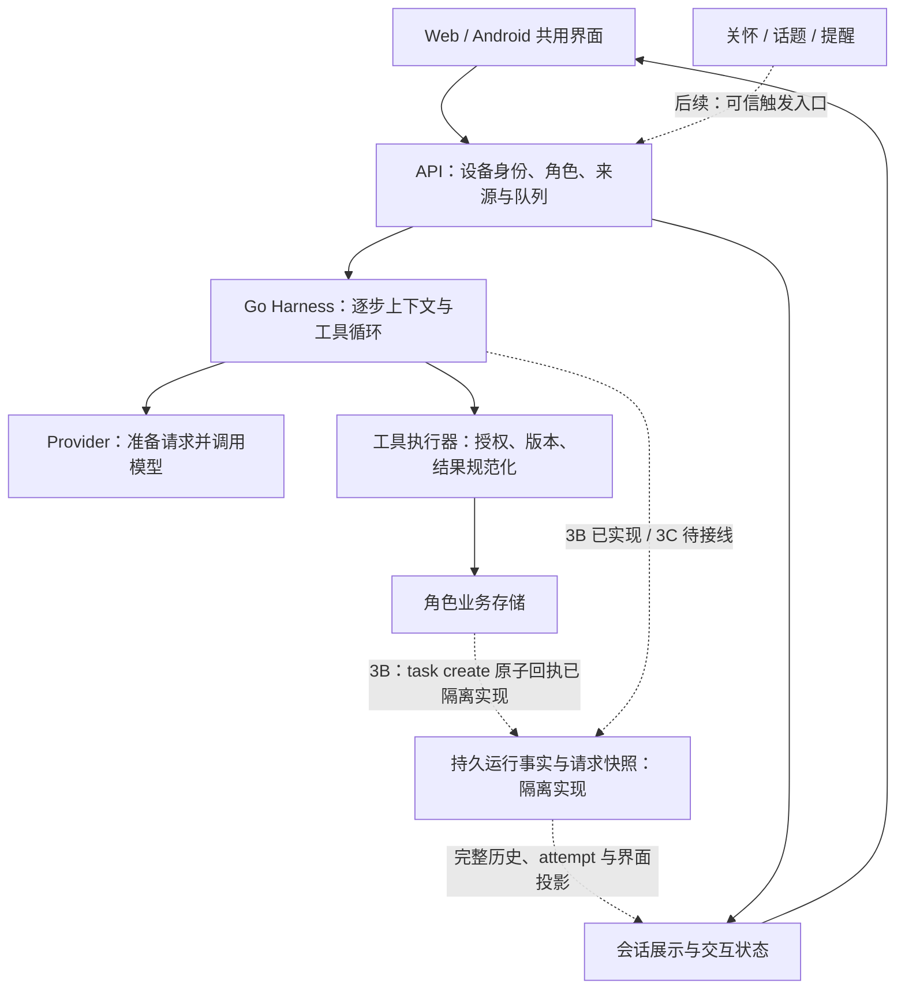

# chat-agent：项目现状、Harness 与陪伴架构规划

更新：2026-11-07。依据当前代码、0.22 发布记录、用户提供的两份 Generative UI 方案，以及固定版本的 DSH 源码文档。0.22 已部署；0.23 Harness 3B 已在隔离源码与临时数据完成，尚未接入生产 API，见[实施记录](release-0.23.md)。版本排期以[当前规划](feature-plan.md)为入口。

## 1. 结论与优先级

继续使用 **Go 服务 + 原生 JavaScript Web/PWA + Kotlin 包装**。当前已有可用的聊天、工具、陪伴、互动渲染和桌面入口；后续价值在于让这些能力共享可靠的运行事实、连续上下文和交互状态。没有足以支持整栈迁移、嵌入 DSH 运行时或重新建设网页端的需求依据。

模型推理在服务端调用 ECNU 完成，本项目主要处理网络、状态、调度和工具执行，Go 已能承载这些职责。TypeScript 的 UI 组件生态可供设计参考，但不要求主服务迁移；Python 的模型计算生态也不是当前瓶颈。只有新增能力出现实际维护或计算需求时，才单独评估依赖或旁路服务。

三条方向分别负责不同问题：

- **DSH Harness 借鉴**：组织上下文和工具，记录真实执行过程，处理取消、失败、结算与恢复。
- **聊天仿生 Agent**：同一个角色如何接话、记事、跟随话题和选择开口时机；由 LLM 在同一轮中选择表达与工具，宿主约束权限和成本。
- **Generative UI**：把有必要的内容变成可查看、可操作、可继续更新的界面；普通交流仍使用自然文字。

0.22 陪伴接续已经部署，0.23 Harness 3B 隔离实现已经完成。下一步保持 **0.24 Harness 3C**，随后优先接通同会话主动陪伴，再按实际需要扩展持久 Generative UI。后两项仍是建议，不视为已经批准的开发或发布任务。

## 2. 当前工程到底完成了什么

当前发布为服务端 **0.22.0**、Android **0.21.2-debug / versionCode 20**。服务目录 `20261106-continuity-ui-01`，APK 目录 `android-20261106-02`；证据见[0.22 发布记录](release-0.22.md)。0.23 尚未部署。

| 方向 | 已实现 | 尚未完成或不能据此承诺 |
| --- | --- | --- |
| 运行时 | Harness 1–2 已部署；3A 契约与容量已冻结；3B 隔离 recorder、attempt/step、请求快照和 task create 原子回执已实现 | 3B 未接生产 API；3C 迁移、重启投影、删除/回退及其他写工具回执未完成 |
| 聊天与参数 | 队列、合并连续消息、停止/恢复、图片、模型选择、思考档位记忆、服务商返回的思考正文显示与保存 | 原“无法回复”问题的原始根因及原会话新消息结果仍未确认；无新一轮真实模型验证 |
| 陪伴与记忆 | 角色、偏好、候选审核、纠正/遗忘、事实/事件/活动参考、活动进展与跨会话只读召回 | 没有独立的长期情绪画像；自然交流质量不能由工具回归通过推导 |
| 主动性 | 概率关怀、人设候选、随机作息与内容筛选、沉默记录、未读约束及部分共享预算 | 关怀和共同话题仍各走一次无工具生成，没有统一的同会话 followup 执行入口 |
| Generative UI | 七组件、来源校验、只读答题回传；Markdown、数学、JSON 树；同实例桌面工作台 | 没有持久 surface/revision、跨轮更新同一界面或任意业务动作协议 |
| 客户端与通信 | 共用网页、Kotlin 包装、设备密钥 challenge/白名单、加密接收、同签名更新 | 单用户、单实例、debug 通道；真机待机与最新版完整交互仍有验收缺口 |
| 桌面使用 | 类 DSH Web 的会话导航、聊天和可展开工作台；SSH 回环访问 | 无公网 HTTPS 入口或本机一键接入启动器；不需要为此另建客户端 |

聊天默认不发送 `max_tokens` / `max_completion_tokens`，沿用服务商默认输出限制。现有网络、文件、工具次数和时间边界仍存在；后台摘要、关怀、话题保留各自成本预算。不能把“不设置聊天输出 token 上限”解释为无限资源或无限 Agent 循环。

当前持久格式必须分别称呼：**生产 transcript v1/v2、生产 turns ledger v1/v2/v3、隔离 runtime 事件 v2**。相同版本数字不代表相同结构；3B 的 runtime v2 尚未成为线上权威。

## 3. 架构如何逐步收敛



实线表示已有主要路径，虚线表示计划接入；关怀和话题当前直接调用无工具生成，不能把图中的统一入口当作现状。新接口优先使用少量 Go 类型、函数与显式依赖，不引入动态插件容器。

### 三种状态必须分开

1. **业务状态**：记忆是否获批、任务是否创建、活动 revision 是否改变，以各业务存储及回执为准。
2. **运行状态**：输入、attempt、模型请求、工具派发与停止原因；未确定结果保留 unknown，取消不会撤销已成功写入。
3. **显示状态**：展开、选项草稿、图表缩放等本地状态，以及将来的服务端界面版本；显示成功不能冒充业务成功。

当前 `internal/api` 同时装配会话、记忆参考、业务工具和后台任务。重构先沿这三类职责提取接口，保留既有 API。`internal/probe` 改名为 `internal/harness` 可以随后做，不作为架构完成标准，也不长期保留两个工具循环。

### 对应的改造入口

下表同时记录已落地接口与后续职责。3B 已新增 `internal/runlog`，其余接口仍优先随具体行为提取，不先建设通用依赖注入或事件总线。

| 当前代码 | 建议职责 / 接口 | 排期 |
| --- | --- | --- |
| `internal/probe/provider.go`、`agent.go`、`compaction.go` | 共用模型消息投影；形成 `PreparedRequest`，在真正发送前冻结用于快照的模型可见数据 | 0.22 → 3B |
| `internal/api/recall_context.go`、`step_context.go` | 有来源的 `TurnContext`；重用本轮召回缓存，刷新 revision/时间/floor，不把动态参考写成用户聊天 | 0.22 |
| `internal/probe/agent.go`、`executor.go`、`internal/turns` | 单一 `RunRecorder` 接收生命周期，失败即封闭写入；投影负责兼容现有历史和 turns API | 3B / 3C |
| 各角色业务 store | `ReceiptStore` 语义：业务修改与回执同次提交；逐操作声明覆盖范围 | 3B |
| `internal/api/life.go`、`topics.go`、`push.go` | 可信 `Trigger` 与会话交接；保留宿主闸门及通知投递职责 | 主动陪伴统一 |
| `internal/interactive`、`internal/api/interactive.go`、`web/ui` | 组件目录、来源校验与 surface 投影；明确区分本地控件、只读回传和业务动作 | 现有维护 → GenUI v2 |

接口抽取跟随具体行为改动完成；不先建设通用依赖注入、插件市场或全量事件总线。

### 先解决一个已定位的上下文口径问题

代码路径显示：`agent.go` 以 `ContextMessagesFrom` 的序列化长度触发压缩；该快照包含保存的最终回答 `ReasoningContent`，而 `provider.go` 只把工具调用消息的 reasoning 传回模型。因而较长的展示用思考正文**可能提前触发压缩**，尽管这部分并未进入下一次实际模型请求。这是代码推导出的风险，尚未证明是线上无法回复的原因。

0.22 应抽出共用的模型消息投影：上下文估算与 Provider 使用一致的消息筛选，区分最终回答的展示用 reasoning 与工具协议必需字段。保留思考显示和原始记录，不将其注入长期记忆、摘要事实或写入授权。3B 的请求快照在相同准备边界冻结，避免保存“模型其实没有看到”的内容后称为实际请求。

## 4. DSH：复用哪些，如何改造

固定参考仍为 DSH `8bd073392eef6f54e921a093b95076248eb08cbb`。本次重读了该版本的[架构文档](https://github.com/deepseek-ai/deepseek-harness/blob/8bd073392eef6f54e921a093b95076248eb08cbb/docs/architecture.md)与[会话投影设计](https://github.com/deepseek-ai/deepseek-harness/blob/8bd073392eef6f54e921a093b95076248eb08cbb/docs/subsystems/conversation.md)，没有自动追随上游最新分支。

| 机制 | 项目现状与下一步 |
| --- | --- |
| 有序提示分区、逐工具使用指引 | 已完成；新增能力继续从实际注册目录生成，避免提示词承诺不存在的工具 |
| 每步准备上下文、工具准入与 Provider 边界 | 已完成基础；补齐实际请求投影和来源类型，保持配置、权限与模型选择分离 |
| turn / step、完整消息与失败 attempt 分离 | 3B 已持久记录 attempt/step 和取消 partial；只有完整提交的消息进入既有历史，生产投影留给 3C |
| 请求快照、运行事件、投影视图 | 3B writer 已实现；3C 接入网页/API 确定状态，不从气泡文本猜执行结果 |
| 收件箱、followup 与上下文注入 | 后续用于可信后台触发；同角色、明确目标会话、受限工具，不将自动触发伪装成用户授权 |
| 稳定节点身份与增量会话投影 | 先减少长对话重建对焦点/滚动的干扰；待稳定 message ID 后支撑可更新的工作台 |
| 服务扩展与插件装配 | 用 Go 接口和静态注册表达需要的扩展点；不实现 Cordis、HMR 或 DSH 插件 ABI |

必须改造的地方：

- **持久代选择**：DSH 的自动代际选择不能直接套用。继续使用本项目显式 manifest、格式登记和删除登记；旧代不能因“更新”或“可读”而自动复活。
- **副作用结算**：运行事件记录执行事实；业务成功需要同一业务提交中的回执。逐工具声明 atomic / none，跨文件操作不假定全局 exactly-once。
- **写入授权**：保留真实用户证据、角色隔离与审核制记忆。工具结果、网页、模型思考和后台提示均不能提升权限。
- **循环与恢复**：沿用有界执行；unknown 不自动重做，重启不自动重放收费请求。后台触发不能借统一 Harness 获得不受限工具和预算。
- **许可**：复用提示词、设计或代码片段继续标注 DeepSeek Harness / MIT；保留现有许可清单。独立 Go 实现，不整包嵌入运行时或插件。

### 3A 容量已在 0.23 对齐

旧契约的 64 KiB 展示文本、4 MiB attempt 总预算无法承接最多 4 MiB 回答、1 MiB 轮次思考及多步快照。0.23 已改为 256 KiB 元数据事件行、128 MiB 请求 snapshot、64 MiB 大 payload 和 1 GiB 隔离会话代；正文使用 hash 文件引用，超限在派发前停止，不截断完整历史来凑预算。保留和删除联动仍由 3C 完成。

迁移输入须覆盖 transcript v1/v2 和 turns v1/v2/v3，同时保留图片依赖、模型/思考参数、部分思考状态与互动原文。详细修订入口见[存储契约](harness-storage-contract.md)；旧预算不再作为可直接编码的最终值。

## 5. 网页 GPT Generative UI：迁移体验和机制

用户的项目专属方案优先于通用示例：现有 `chat-ui` fenced JSON、原生组件和普通队列已经落地。通用方案中的 React/Rust、虚构 `render_ui` 工具以及另一套 `version/blocks/actions` 结构，不直接替换当前协议。

### 外部实现提供的参考

| 来源 | 适合借鉴 | 本项目采用方式 |
| --- | --- | --- |
| [OpenAI 公开 UI 文档](https://developers.openai.com/plugins/build/chatgpt-ui)及[界面指引](https://developers.openai.com/plugins/concepts/ui-guidelines) | 内容处理与呈现分工；轻量卡片、需要时展开的交互空间 | 借鉴交互组织。公开 MCP Apps / 组件接口不是 ChatGPT 私有网页实现的公开源码；本项目无需依赖 OpenAI 模型或安装该运行时 |
| [assistant-ui Generative UI](https://www.assistant-ui.com/docs/tools/generative-ui) | 组件词汇表、模型声明布局、已知组件负责可信渲染 | 保留原生 JS 的目录与校验；不为获取组件目录整体迁移前端 |
| [AI SDK Generative UI](https://ai-sdk.dev/docs/ai-sdk-ui/generative-user-interfaces) | 将结构化工具结果映射为组件，区分运行状态和展示 | 真实业务工具已有结果可供展示；首版纯展示继续使用消息块，不额外占用四次工具预算 |
| [A2UI](https://a2ui.org/concepts/overview/) | 声明式组件、数据绑定及界面更新消息 | 将来设计 surface/revision 时参考；只有出现跨客户端互通需求才做适配器，不宣称 chat-ui v1 已兼容 A2UI |

### 当前能力与下一层

已有七类：单选题、填空题、折线图、矢量图、数据表、柱状图、流程/关系图。每块 8 KiB、每条最多四块；完整来源、消息 hash、角色和会话通过检查后才允许提交。答题通过原消息队列进入只读反馈轮；不完整流只可预览。LaTeX/Markdown/JSON 不必为了显示而包装成工具。

后续分两层推进：

1. **现有协议维护与体验**：整理组件目录元数据，减少 Go / JS / Schema / 提示词分别维护的偏差；保留服务端校验。改善按稳定身份更新的渲染、工作台定位、思考折叠、流式滚动和键盘操作。只对实际出现的问题修改，不进行视觉框架重写。
2. **持久界面 v2**：在 3C 的稳定身份之上增加 `surface_id`、`revision`、来源 message/turn 以及受限的创建/更新/关闭事件。同一图表或活动面板可以被后续回答更新，旧版本按钮必须明确过期，刷新与断线恢复不能重复执行动作。

v2 先复用受限目录，布局只允许少量容器。对话产物使用紧凑、完整校验的更新事件，不以任意 HTML/JS、动态组件下载或无限 JSON Patch 换取灵活性。是否将呈现单独暴露为工具，等持久事件和预算语义成熟后再定；首版不新增假工具。

交互分三类，权限不能混用：

| 动作 | 模型与持久化行为 |
| --- | --- |
| 展开、选项草稿、缩放、滑块演示 | 默认本地计算，零模型请求；未提交内容不自动写为用户事实 |
| 明确“提交答案 / 继续解释” | 绑定来源与 revision，进入现有队列，同 ID 去重；沿用允许的只读工具 |
| 保存进展、创建任务等业务动作 | 独立的、明确的用户授权与宿主校验；使用 operation ID 和业务回执，不能借普通答题通道写入 |

优先考虑服务于陪伴的内容卡片、共同活动时间线和简单对比图，出现真实需求再加类型。用户方案中的波形/频谱需要真实音频与确定性 DSP 数据；当前系统语音只返回文字，不能靠 LLM 编造采样点冒充分析。完整 Mermaid 源码、音频消息与实时语音分别评估。

### 电脑端使用方案继续复用

已有三栏布局和同实例工作台，宽屏侧栏与窄屏覆盖层移动同一个组件实例，保留草稿。继续使用[SSH 隧道方案](desktop-web-plan.md)访问服务端回环 HTTP；外部链路由 SSH 加密，设备审批仍有效。以后如接入步骤成为实际障碍，再做本地连接启动器或 HTTPS 网关，模型密钥仍只留在服务器。

## 6. 聊天仿生 Agent：重点是连续关系和时机

目标是让交流自然、持续、有边界，不是增加显式“倾听/建议”开关，或每轮额外调用一次分类器。现有 `companion.Policy` 已教模型跟随话题、避免机械复述和强行追问；下一版必须改变参考组织和执行路径，不能把同一组提示词换说法再算一版。

### 0.22 先改善当下交流

- **当前意图优先**：直接求助时提供实质帮助；随口分享不强制转成任务或心理分析；情绪表达不默认开启问诊式追问。
- **接续有来源**：从近期完整消息、已有摘要、获批事实和活动记录选取相关内容；保留发生时间与来源，区分打算、已发生、取消和用户纠正。
- **减少重复**：将近期已问的问题、已分享的来源和未回应事项用于本轮参考与抑制；先用现有历史/记录，不新增无依据的情绪评分数据库。
- **跟随转向**：用户改话题后不反复拉回旧目标。没有可靠依据就表达不确定，不为表现“记得”而补造细节。
- **角色保持一致**：允许有稳定兴趣、语气和适度不同意见；人设演化仍走候选审核，不编造离线生活，也不用内疚、占有或假装需要照顾来维系互动。

一次响应内由 LLM 自主决定是否搜索、引用记忆、更新获准进展或展示组件。新增参考必须有容量和失效规则，不把所有长期资料、所有未办事项都塞进每一轮。

### 主动搭话进入同一条会话

已交付的 speak-up 概率闸门、soul 候选和话题作息继续保留；未读限制、跨话题/关怀检查与共享额度已有部分实现。后续补的是目标会话、内容连续性和统一执行记录，不是重新从零实现定时器。

建议使用宿主生成的触发信封：`origin`、角色/目标会话、触发 ID、时机、依据引用、预算和允许工具。触发来源不由模型或客户端任意声明。处理顺序如下：

```text
获准的触发 → 安静/忙碌/未读/额度检查 → 同一机会只抽样一次
         → 有相关内容才生成 → LLM 可选择不分享
         → 保存运行结果与消息 → 发通知 → 用户回复接续同一上下文
```

| 来源 | 执行约束 |
| --- | --- |
| 用户聊天 | 保留真实用户证据与现有工具权限 |
| 互动答案 | 校验来源；只读反馈 |
| 自动关怀 / 内容话题 | 仅在用户启用的范围内运行；先用受限只读工具，禁止自动改人设、批准记忆或创建任务 |
| 明确提醒 / 获准跟进 | 不被随机沉默吞掉；确定性通知与可选的表达生成分开，前者不依赖 LLM 成功 |

完整的同会话 followup 待 3C 后接入，避免后台重启重复开口、重复收费或重复写入。既有 0.22 参考、时机和重复抑制继续保留。

“两本日记”保留为实际运行观察/选择记录与给用户的分享记录。它们来自真实执行事实，模型输出的思考正文不自动成为日记、长期记忆或已发生的经历。

## 7. 建议版本与最小完成标准

| 顺序 | 范围 | 完成标准与边界 |
| --- | --- | --- |
| 必要的 0.21.x 修复 | 新出现的无法回复、思考显示、队列恢复问题 | 按具体复现修复；不将旧 4096 输出配置直接认定为原故障根因，不默认再发送私人历史诊断 |
| **0.22 陪伴接续** | 对齐模型消息投影；改进参考/摘要接续、纠正与重复抑制；按反馈完善现有 UI | 少量固定上下文例子覆盖换题、计划/实际、纠正、无关记忆与重复追问；最终思考不误计模型历史体积，工具协议字段仍保留；不迁移运行存储 |
| **0.23 Harness 3B（源码完成）** | 已修订容量并实现实际请求快照、attempt/step、工具生命周期和 task create 原子回执 | 隔离目录已验证“业务成功、运行结果失败”、取消 partial 与不重跑；未切换生产数据格式 |
| **0.24 Harness 3C** | 显式迁移、重启投影、删除/恢复与回退；保留 UI 来源和图片依赖 | 迁移失败保留明确权威；删最新轮/整会话后重开不复活；未完成回答不可提交组件；达标后才安排生产切换 |
| **后续 A：主动陪伴统一** | 可信触发、受限 followup、目标会话、注意力和内容去重 | 沉默不花模型费用；已处理触发不重复生成；用户回复能接上此前话题；明确提醒不受随机闸门影响 |
| **后续 B：GenUI v2** | 稳定 surface/revision、跨轮更新、必要的组合布局与业务动作 | 一条“生成 → 本地操作 → 明确提交 → 刷新恢复”流程；版本过期和来源删除拒绝动作，业务结果以回执为准 |

0.22 的对话改进与既有组件小修已经上线；持久界面、业务写按钮和可恢复的后台执行仍需 3C 的可靠身份、投影与删除边界。新增通用组件、MCP 生态适配、第三方 IM、平台账号自动浏览、全双工语音和动态插件市场继续按需单列。

## 8. 实施纪律与证据边界

只保留与变更直接相关的关键行为检查。上下文修正用本地模拟 Provider 检查实际消息；存储用少量故障注入；界面用一条完整交互流程。不新增措辞快照、完整组合矩阵或独立审查代理。

真实模型体验与工程正确性分别记录。0.22 构建、界面检查和线上零模型检查是当前生产基线；0.23 只使用确定性 Provider 与临时数据，不据此声称真实模型或生产恢复已验收。Android 真机和待机仍待条件具备，也不因缺少手机停下所有独立开发。

本次仅核对代码、查阅公开文档并整理计划，没有运行模型诊断、读取私人会话或变更线上数据。后续实施范围按具体任务推进；相关详细文档为 [Harness 迁移](dsh-harness-migration-plan.md)、[持久契约](harness-storage-contract.md)、[GenUI v0.1](generative-ui-v0.1.md)、[桌面工作台](desktop-web-plan.md)及[陪伴机制](companion-mechanism-plan.md)。
