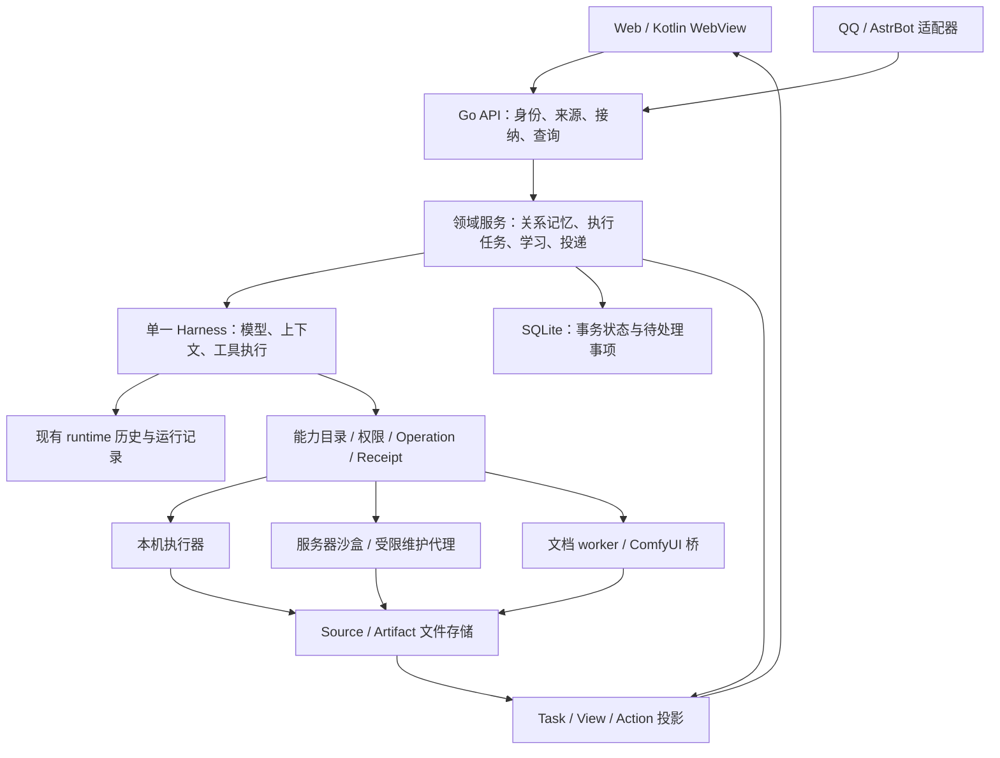

# CA 架构改造与体验实施方案：交给 DSH

日期：2026-11-29。源码基线：`723845a25355b95a1c7593d503ff0b36e88ab441`。本文给出技术选型、模块边界、体验要求和交付标准，不安排工期或版本。

本次核对了当前源码、已有改进指南、DSH/Aurabot/AstrBot 的本地固定版本和相关技术的官方文档。未运行生产诊断、真实模型请求、真机验收或部署。下面区分已有实现、源码可确认的缺陷及新设计；新设计不能当成已上线能力。

## 结论

**保留 Go Core 和 Kotlin Android 包装；将 Web 渐进改为 TypeScript + React + Vite；引入 SQLite 承担需要事务的可变状态；以成熟文档处理组件替换自制 PDF 提取。** 核心仍是一个可独立运行的 Go 应用，电脑本地和服务器使用同一套 Harness。

理由来自当前问题：前端已经需要稳定组件身份、跨刷新交互状态和 DSH 组件复用；任务、设备、投递需要明确的提交与恢复边界；课件需要中文、页码和原页可靠性。仅增加 CSS、提示词或重试无法补齐这些能力。

改造服务于七个用户体验：持续相处、恰当主动、完成长任务、统一工作台、课件学习、跨入口接续、协调本机与服务器资源。服务器小精灵和 ComfyUI 归入资源协调，插件化贯穿所有方向。

本方案在现有原生 Web 和文件存储基线上，提出新的前端组件与事务状态存储目标。[11 月 28 日改进指南](local-agent-improvement-guide-2026-11-28.md)中的正确性要求继续有效。紧急修复直接在现有实现完成，不等待 React 或数据库迁移。

## 1. 技术栈决策

| 层次 | 决策 | 产品依据与约束 |
| --- | --- | --- |
| 核心服务 | 保留 Go、标准库 HTTP、现有 Provider 和 Harness；按领域拆职责 | 会话、权限、业务结算需要单一管理者。当前问题不要求迁移到 Node/Python 或拆成微服务 |
| Web/PWA | TypeScript + React + Vite，CSS Modules + 现有 DSH 设计 token | 组件生命周期用于保护交互状态，类型用于统一契约，构建 manifest 用于资源版本管理；优先移植适合的 DSH 展示组件 |
| Android | 保留 Kotlin + WebView + Keystore + 原生文件/通知桥 | 共用网页体验；原生层处理身份、系统文件交付、后台通知及更新。此次不重写为 Compose 或 React Native |
| 可变业务状态 | Go `database/sql` + SQLite，首选 `modernc.org/sqlite` | 设备/密钥、独立执行任务、调度租约、投递、学习作答需要事务。该驱动不依赖 CGo，适合现有 Windows 构建 Linux 的流程；锁定版本及匹配的传递依赖 |
| 历史与大文件 | 保留 manifest 选代的 runtime 历史；原件/成果保存在文件存储 | 数据库不吞并全部历史和二进制。现有业务回执仍是相应业务结果的权威来源 |
| 文档处理 | PDF.js 查看原页；受限 worker 调用 Poppler；PPTX 原页转换采用 LibreOffice headless | 补中文文本、页级来源、版面与提取质量；扫描页按需 OCR/视觉理解。浏览器不承担后台权威提取 |
| 执行和调度 | Go 持久作业 + OS 执行适配器；复用现有 Linux 沙盒和图像桥 | 长任务脱离单次 HTTP/LLM 请求生命周期；当前规模无需 Redis、Celery 或 Kubernetes |
| IM | 保留 QQ 官方 Go 适配器与独立 AstrBot Python 桥 | 渠道只负责消息、身份映射、媒体与投递；CA 持有对话和 loop |

React 支持逐区域接入已有页面；Vite 支持生成供传统后端使用的构建 manifest。因此生产环境仍由 Go 提供静态资源，Node 只进入前端开发/构建流程。[React 渐进接入](https://react.dev/learn/add-react-to-an-existing-project)、[Vite 后端集成](https://vite.dev/guide/backend-integration.html)。SQLite 驱动选择依据见 [modernc.org/sqlite](https://pkg.go.dev/modernc.org/sqlite)。这些是本项目的选型判断，并不意味着换框架会自动修好状态问题。

### 目标结构

这是目标职责图，不要求新增同名包或网络服务。现有 `internal/tasks` 是待办/提醒，不能直接当作执行任务仓库重命名；执行领域从 `internal/turns`、`internal/runlog` 和实际作业存储演进。

### 数据迁移边界

SQLite 只接管明确迁移的领域。每个 Core/私有实例持有自己的数据库、密钥和数据目录，本地与云端不挂载同一份数据库。先完成设备登记的逻辑修复，再将设备、凭据及槽位在同一事务中维护；新增独立作业、意图租约、outbox 和学习记录可直接使用新存储。尚未迁移的队列、记忆和业务回执继续使用原权威存储，通过接口访问。

每次领域切换都要有 schema 版本、停写迁移、核对、明确启用点和回退快照。禁止长期同时写 JSON 和数据库，再用“时间更新的一份”决定真值。旧 turn 到 Task 的兼容投影保留，不能制造一套独立状态覆盖原事实。现有 events 不能重建全部历史，继续遵守[存储契约](harness-storage-contract.md)。

数据库事务不能包住外部 shell、模型收费请求或 QQ 发送。跨进程采用持久意图、业务回执和结果核实；无法确认时保留 unknown。大文件先写入并校验，再登记引用；未登记的孤立文件可延后清理，不能先暴露不存在的下载。

采用 WAL 时使用本机磁盘、短写事务和有界等待。备份通过备份 API，或停写并完整关闭后复制；不能在线只复制主数据库文件。SQLite WAL 允许读写并行，但仍只有一个写者。[WAL 约束](https://sqlite.org/wal.html)、[备份 API](https://sqlite.org/backup.html)。

## 2. 七个方向分别改什么

### 2.1 持续相处：角色、记忆与自然接话

**目标体验**：用户能手动定义助手、纠正它的认识；连发、换题和跨天接续自然；重要的共同经历可以找回。

**技术改造**：保留 Go 角色与记忆服务、Markdown 角色设定、审核制记忆和既有气泡能力。把关系上下文整理为稳定偏好、已确认事实、共同经历、短期话题四类引用；运行中的任务进度继续属于 Task。每项记录来源、版本、有效期和纠正关系，读取使用同一 ContextSource。现有关键词/语义检索先按真实漏召回样本改进，不另加通用向量数据库作为前提。

人设与长期事实由用户直接编辑，AI 修改继续提议审核。人格风格不随一次情绪猜测永久变化。新版本记忆和遗忘要影响摘要与检索，避免“删过又回来”。语义气泡仅是权威回复的展示分段，代码、公式和长篇解释保持完整，不增加机械发送延迟。

**UI**：点击助手名称进入一张“助手资料”，集中放角色、表达偏好和记忆；消息菜单提供“记住／纠正／忘记／查看来源”。候选审核在相关消息旁出现，侧栏无需恢复多个记忆管理入口。角色切换不再作为“陪伴/计划伙伴”模式暴露。

**交付判断**：修改一条偏好后 App 和 QQ 的获准私聊都使用新值；删除事实后不从旧摘要复活；用户换题可自然结束旧话题。主要入口：`internal/roles`、`internal/memory`、`internal/api/recall_context.go`、`internal/api/step_context.go`、`web/companion.js`。

### 2.2 恰当主动：有依据地想起用户

**目标体验**：能接续“明天考试”“文件处理完告诉我”等真实事项；有值得分享的内容才开口，用户能够理解和调节主动行为。

**技术改造**：Go 领域调度器 + 持久意图 + 租约 + outbox，接入同一个 Harness。Aurabot 的目的调度、候选筛选、相似性抑制和沉默机制优先复用适配。正常聊天的 LLM 可调用工具提出短期跟进意图，记录来源、类型、最早时间、过期时间、失效条件和获准去向。

廉价规则先检查来源有效性、安静时段、未读、重复和预算；候选值得判断时才调用模型。明确约定和提醒按约定执行，自发问候才受概率控制。后台允许少量读取、检索和作业查询，不依赖目前“一次无工具回复”覆盖所有主动场景，也不获得前台任意写权限。

当前调度以任意会话忙碌为由跳过，需改为按目标会话串行、全局容量公平调度。发送前再次检查用户是否已回复或事情已完成。持久化“未触发／选择沉默／待发送／已送达／待核实”，避免把“生成过”当作“主动发到用户”。

**UI**：设置只让用户表达“可主动联系／少一点／暂停”和安静时间；具体消息可选“这个话题结束”。“少一点”降低同类触达，“暂停”才静音。显示简短、可展开的来源说明，例如“接着昨天的考试聊聊”，不展示骰子和调度参数，不制造已在线下行动的假象。

**交付判断**：约定得到跟进、过期事项沉默、负反馈作用于对应类别；一次主动内容只通知一个明确目的地。入口：`internal/api/care_continuation.go`、`proactive.go`、`push.go`、`internal/companion/life.go`。

### 2.3 完成长任务：Harness 与双端 Agent

**目标体验**：提出目标后助手持续处理；用户可以补充、暂停、离开页面再回来；过程和成果能查清楚。

**技术改造**：继续使用 Go loop，完善持久 Task、已有 attempt/run、Operation、Receipt 和 Artifact 的关联。Task 表达用户目标，可以跨多次运行；旧普通聊天先兼容映射，不把每句闲聊都变成任务管理流程。不要把目前“一个 turn 投影一个 Task/Run”当成完整持久工作流。

运行中输入先持久接纳，带 request ID、目标 run、来源、附件和应用状态；在安全 step 边界进入后续上下文。接纳、已应用、转下一轮必须可查询。最终模型请求已经发出时，保留补充并给出续接状态；不能删除队列后只放内存，更不能以一条临时提示代替持久用户指令。

短工具直接返回；长 shell、文档转换和图像请求返回 job/operation 引用，由宿主观察完成后续跑。观察同一作业不属于无效重复调用；去循环判断结合副作用、结果版本和实际进展。工具期限、模型请求期限、等待授权、任务总预算分开；不通过简单放大五分钟超时制造长任务。

工具目录与每步 ToolSet 分离，48 的限制仅约束提供给模型的集合。提供受权限过滤的能力发现；模型可申请加载相关工具，宿主最终裁决。扩展现有 ToolResult/插件 Result 的结构化状态、成果和恢复建议，不再从展示用 JSON 文本猜结果。只对声明且验证并行安全的读取做有界并发。

**UI**：任务卡显示目标、当前步骤、执行位置、等待原因和成果。“补充到当前任务”是这次发送的意图，发送后恢复默认；普通发送仍可排下一轮。收到“已接纳”的确认必须对应落盘。停止按钮表达取消请求，真实进程结束后才显示已停止；未知结果提供“核实进度”，不引导用户盲点重试。

**交付判断**：任务经过补充、掉线和重启仍能说明输入在哪里、哪些动作已提交、如何继续；成果可下载。入口：`internal/probe`、`internal/turns`、`internal/runlog`、`internal/api/turn_submission.go`、`internal/localagent`。

### 2.4 统一工作台：DSH/GPT 风格 UI 与 GenUI

**目标体验**：默认是干净的聊天；需要读资料、看结果和操作任务时，自然展开工作区；手机上不会因流式输出打断阅读或输入。

**技术改造**：采用 TypeScript + React + Vite + CSS Modules。复用现有传输、设备身份和协议校验，先迁移工作台/任务视图，再把聊天消息树作为完整区域迁移。每个区域只有一个 DOM 所有者；旧 `app.js` 不得重建 React 管理的子树。不能给每个流式片段临时挂一个 React root。

前端状态分三层：服务端业务投影、连接/请求状态、本地交互状态。初版用明确 reducer、订阅与 React 自带能力，不叠加 Redux 等全局框架。组件 key 使用稳定消息/操作/视图 ID，不能使用下标或文本。菜单展开、思考滚动、选区、草稿与答案由身份关联，不能因业务 revision 更新全部清空。

DSH 的 ToolDetails、ToolRow、ToolCallTree、ApprovalCard 可挑选源码适配；将其 connection、locale、slots 和 Cordis 依赖替换成 CA 的数据与动作接口，保留适合的 CSS/交互。已有 token 和 KaTeX 延用；迁移一个区域即收回其旧覆盖样式，减少现在 14 个样式文件相互覆盖的情况。

GenUI 延用现有协议和学习 surface，扩展宿主验证的 View/Action。Action 关联实体、预期 revision、幂等请求和当前授权；普通折叠、复制、图表拖动留在本地，业务变更提交到 Core。模型生成的任意 HTML/JS 只能成为隔离成果，不能执行在已登录应用域。

Vite 构建输出哈希资源，由 Go embed 发布；Service Worker 使用同一资源 manifest。构建入口先生成前端产物，再构建 Go；`web/embed.go` 的静态路径白名单也要随 manifest 更新，避免新资源被旧白名单返回 404。新旧页面各自加载完整的一代资源。激活更新先保存草稿，运行中不强制刷新。关于页分别展示服务、网页资源和 APK 版本，首页只给一个清楚的更新提示，避免把服务版本误报成安装包版本。

**UI**：侧栏只保留新对话、搜索、最近会话，底部一个账户/设置入口。任务、资料与成果在会话上下文打开；桌面侧栏工作台，手机进入可返回的全屏面板。工具细节默认收拢，错误、授权和最终成果清楚可见；服务商实际返回的思考可正常展开、复制和阅读，不补造未返回内容。

**交付判断**：持续输出中阅读思考、展开工具、选择文本和填答案均不复位；手机返回后回到原位置；刷新恢复同一业务视图。入口：`web/app.js`、`desktop-workspace.js`、`web/ui`、`internal/presentation`、`internal/api/study_surfaces.go`。

### 2.5 课件学习：分析、讲解、练习与复习

**目标体验**：上传课件后能对着原页提问、讲解和自测；答案有出处，错题能接着学，生成的学习成果可保存。

**技术改造**：Go 负责文档/提取作业/来源/学习记录；PDF.js 负责原页查看与选区；Poppler 负责受限环境内的 PDF 提取及页图；LibreOffice headless 按需把 PPTX 转为可预览 PDF。各组件锁定兼容版本，采用安装清单管理；不向核心链接新的文档 C/C++ 库，也不继续扩张当前扫描 stream 字面字符串的解析器。

先保存原件与 hash，再异步提取，失败仍能下载原件。SourceRef 绑定文档版本、提取版本、页/幻灯片及定位。记录每页提取状态和覆盖范围；中文、字体映射、阅读顺序与公式不能仅凭“提取到一些文字”宣告成功。扫描页和公式需要 OCR/视觉时明确标注来源与可信度；不把 OCR 当可靠公式解析器。

题目版本、用户作答、评分和学习进度是独立业务记录；GenUI 是投影。未提交答案保留草稿，提交后幂等落盘；答案与评分依据留在服务端，前端不会因隐藏了答案文字就被视为保密。选择题按既定答案评分，开放题才调用模型，评分标注对应资料与题目版本。

EduWork 重点借鉴原页—选区—讲解、互动练习和学习成果组织。实际复用先检查其具体文件与许可证，不能因仓库公开就视作可直接复制；本次未把未核实的插件列为可安装依赖。

**UI**：上传后展示“已保存／正在解析／可用页数”，手机看原页和提问可来回切换且保留位置。选区后可“解释这段／举例／出题”；这些是一次动作，不是长期对话模式。学习页聚合资料、进度、错题和笔记，避免让用户手动维护独立的多个管理页。

**交付判断**：一份中文课件完成上传、原页引用、讲解、自测、提交评分及复习，刷新后可续接。入口：`internal/courseware`、`internal/interactive`、`internal/api/study_surfaces.go`、`web/courseware.js`、`web/ui`。

PDF.js 官方区分解析、显示和 viewer 层，适合在 CA 内采用显示接口并构建自己的查看器；其项目采用 Apache-2.0。[PDF.js](https://mozilla.github.io/pdf.js/getting_started/)、[许可证](https://github.com/mozilla/pdf.js/blob/master/LICENSE)。[Poppler](https://poppler.freedesktop.org/)和 [LibreOffice 命令行](https://help.libreoffice.org/latest/en-US/text/shared/guide/start_parameters.html)提供成熟处理能力。引入、打包和修改按实际版本核对许可；进程分离本身不代表免除分发义务。[LibreOffice 许可说明](https://www.libreoffice.org/licenses/)。

### 2.6 App/Web/QQ 接续：共享上下文，明确消息去向

**目标体验**：在 App 说过的事情，QQ 私聊能接着聊；图片、表情包和附件可理解；用户知道消息有没有送达。

**技术改造**：保留 QQ 官方通道和 AstrBot 桥，统一输入信封、账号映射、稳定消息 ID、媒体引用和投递分段。绑定的同一用户私聊沿用明确选择的 App 会话；共享记忆和共享当前 transcript 是两个层次，不能只做记忆召回就声称上下文已共享。

输入先去重落盘，再进入 CA 队列；输出先持久保存投递意图，再发送。多气泡按 part 保存平台回执，已确认的片段不随整条重发。平台不能查明是否发送成功时显示待核实，不假定 exactly-once。内容相同不代表同一条消息，去重依赖平台消息身份和 CA 请求身份。

图片、附件、GIF/WebP 与表情包归一成媒体记录，保留原件和兼容预览；明确什么可以传给当前模型、什么只可下载。引用消息带来源，不用一段格式化引用冒充用户新授权。App 的回复默认留在 App；来自 QQ 的输入回复原私聊，主动消息按用户偏好选择一个去向。

**UI**：私聊首次关联时显示当前关联会话；之后不要求逐次切换。会话内用低干扰标记说明消息来自哪里，失败时在那条消息上恢复。技术上的平台 token、连接参数留在高级设置。群聊使用独立受众范围，不顺带开放私人历史或继承 App shell 授权。

**交付判断**：两端接着同一话题，引用与附件可追溯，部分送达后不重复刷屏。入口：`internal/channel`、`internal/api/turn_submission.go`、`integrations/astrbot-chat-agent/main.py`、`internal/media`。真实 QQ 交付仍需有条件的一次真实私聊核实，源码或模拟桥测试不等同于真实可用。

### 2.7 协调资源：本地、服务器小精灵与 ComfyUI

**目标体验**：电脑本地打开即可工作，手机可以使用服务器沙盒；模型能在获准范围内编排 shell、处理文件并交付成果，生图和服务器维护有准确进度。

**技术改造**：两个完整 Go Core 分别持有本地和云端 loop；共用 ExecutionBackend 能力接口与作业契约。云端访问另一台电脑时才走现有远程连接。能力探针把实际可用的文件、shell、网络和图像能力送入工具目录，避免模型明明有服务器沙盒却只知道绑定设备。

网页能力作为统一沙箱管理器下的 `web_exec` 执行适配器，和 shell 共用任务、授权、累计预算、工作区、取消恢复与成果管理。一个任务可以连续检索资料、处理文件、核对来源并导出；浏览器 profile/凭据及不同执行器的网络权限保持隔离。详细契约、双端运行与合并验收见[统一沙箱与双端网页执行方案](web-execution-design-2026-11-29.md)。

Linux 延用非 root、Landlock/seccomp 和受限临时目录，增加每作业进程树管理、资源额度、持久日志与成果导出。LLM 可自由组合获准工作区内的 shell，不用命令关键词白名单冒充隔离。联网通过独立受控能力提供；现有 shell 禁止 socket 时要如实反馈。隔离不可用时保持 `SANDBOX_UNAVAILABLE`。[Landlock 官方边界](https://www.kernel.org/doc/html/latest/userspace-api/landlock.html)。

Windows 自由 shell 的目标是 AppContainer 能力边界配合 Job Object 生命周期与资源管理。先证明实际目标程序能在授权目录内运行且不能越界，再开放该能力；当前非 Linux 后端不能当作已有同等隔离。Job Object 本身不足以限制文件和网络权限。[AppContainer](https://learn.microsoft.com/en-us/windows/win32/secauthz/appcontainer-isolation)、[Job Objects](https://learn.microsoft.com/en-us/windows/win32/procthread/job-objects)。

服务器小精灵通过独立维护代理管理服务状态、日志、版本及批准的变更。管理范围可以覆盖主机，Core 仍不用 root 身份执行任意模型 shell。读写策略按服务/目录/操作类型划分；修改前说明影响、执行后复查，维护代理核验宿主授权，而不是相信模型传来的“已批准”。

ComfyUI 保留已有 job ID 和桥，不重新实现一套生图系统。补上 CA operation 到 renderer prompt/job 的持久映射、后端查回、进度、取消结果和成果登记。提交结果不确定时先核实，不自动重复生成。桥在线、隧道在线和模型就绪分别检测；断线只影响连接状态，不能直接判定作业失败。

**UI**：默认采用当前 Core 所在环境，任务卡注明“这台电脑／服务器”；涉及跨端传文件时说明范围。连接管理页变成按需出现的资源状态，日常无需绑定才能工作。作业交付统一文件卡，提供预览、原件下载和版本；保存到手机由 Kotlin 下载桥处理，模型不直接填写任意下载地址。

**交付判断**：同一个“整理附件并导出”请求在本地或服务器均有真实成果；离开页面不终止已接纳的任务；ComfyUI 重启后能核实原任务。入口：`internal/sandbox`、`plugins/builtin/workspace`、`plugins/builtin/server`、`internal/localagent`、`internal/api/image_jobs.go`、`cmd/imagebridge`。

## 3. 贯穿各方向的两个机制

### 3.1 身份与权限：同一用户的设备等效

账户持有一组逻辑设备；设备持有可轮换的凭据。公钥指纹属于凭据，不能继续同时充当“物理设备”和“用户”的唯一身份。服务端标识稳定，与当前 IP、域名、隧道地址分离；Android 复用 Keystore，Web 在固定可信 origin 与浏览器 profile 内复用 IndexedDB 身份。

系统信息、User-Agent、屏幕等 digest 只能辅助命名或发现疑似重复，不能证明持钥或自动合并信任。浏览器之间、清除站点数据或卸载重装后，不能承诺自动认出同一物理设备。已有信任设备可通过一次受控确认关联新凭据；日常重连和换传输方式不生成新条目。

UI 按逻辑设备显示一行，默认显示名称、最近使用和撤销；凭据历史折叠。114 条历史记录先按可证明的关联提出合并/归档预览，不按相似名称直接删除。未授权登记不得改变已有 approved/revoked 凭据。

同一账户已批准设备共享资源与管理权限。操作授权关联用户、任务、资源和副作用范围，而不是偶然由哪台手机发起。文件原件写入、外部发送和主机维护的批准单独呈现；一次已批准的任务可在原范围内持续执行，改变目标或扩大权限才重新确认。

### 3.2 插件化：能力可替换，日常无需管理插件

保留 `internal/pluginapi` 的 manifest、生命周期、服务与工具注册；围绕实际消费者扩展 Provider、ContextSource、Trigger 和 Renderer。模型路由验证 Provider，记忆/课件验证 ContextSource，主动陪伴验证 Trigger，任务与学习面板验证 Renderer。插件停止时撤销新准入，已有作业由 Core 记录并明确完成或中止。

身份、权威会话、授权和结算是核心能力，不能由插件绕过。模型参数、UI 参数和原始业务结果分别表达；插件沿用现有 Result.Data/Receipt 等入口扩展，不另外创造平行协议。客户端 renderer 使用宿主可信组件或构建时审查过的源码，不能动态加载模型提供的脚本。

## 4. UI 交互与人因工程要求

| 用户问题 | 交互设计 | 工程落实 |
| --- | --- | --- |
| 想聊天，却先要学习很多设置 | 首页回到最近会话；只在任务需要时出现资料/资源/审批 | 渐进披露，管理能力集中；避免给每个插件新增侧栏菜单 |
| 正在看思考，页面被拉回底部 | 区分“跟随新输出”和“正在阅读”，显式按钮回到最新 | 用户滚动、选择或操作详情即保持阅读位置；图片加载与新 token 不重置状态 |
| 工具详情、菜单和输入反复复位 | 已展开区域及当前编辑持续保留 | 稳定 key、局部更新、独立 UI 状态；不能用 textContent 相同判断视图等价 |
| 不知道助手是真在做，还是卡住 | 始终能看到正在执行、等授权、等设备、待核实及下一步 | 状态来自业务投影；连接断开、请求完成、任务完成分别处理 |
| 不敢点击批准，或被反复打扰 | 原地说明目标、范围、影响；可批准当前任务范围 | 票据绑定操作/范围，幂等回答；不接管或抹掉输入草稿 |
| 手机上面板太挤，返回后丢位置 | 一个主要滚动区，资料/详情按需全屏，返回恢复原锚点 | VisualViewport、safe-area、键盘避让；焦点恢复、返回栈、避免多层滚动争抢 |
| 小图标误触、暗色底部白块 | 触控区域建议 44–48 CSS px，危险操作与发送分开 | 统一语义 token 与组件样式，检查 disabled/hover/focus/弹层；不只靠颜色表示失败 |
| 中文输入法回车误发送 | 选词期间不触发发送，发送后清除的是已接纳那份草稿 | 处理 composition 状态与请求身份；失败保留文字和附件，重复点击可去重 |
| 读屏或键盘操作被弹层阻塞 | 焦点可见、关闭后回到触发点、状态通知不过度打断 | 合理 aria-live、减少动画选项、焦点不被输入区/浮层盖住 |
| 更新后仍显示老版本 | 提示可用更新，刷新前保存工作；关于页能区分三端版本 | 构建 manifest、带 hash 资源和可控 SW 激活，避免手写多份版本字符串 |

触控尺寸是本项目的设计目标。WCAG 2.2 的最低目标尺寸为 24 CSS px，并有间距等例外，不能把上述 44–48 误称为该标准的统一最低要求；焦点可见性另行检查。[目标尺寸](https://www.w3.org/WAI/WCAG22/Understanding/target-size-minimum)、[焦点不被遮挡](https://www.w3.org/WAI/WCAG22/Understanding/focus-not-obscured-minimum)。

## 5. 当前缺陷与待复现问题

以下“源码确认”指本次读到的实现路径，不表示已在生产制造或复现故障。详细根因与最小行为要求见[改进指南](local-agent-improvement-guide-2026-11-28.md)。

| 优先级 | 证据与入口 | DSH 应修什么 |
| --- | --- | --- |
| 先修 | **源码确认**：`turn_submission.go` 接纳补充到内存后删除队列；`assembly.go` 只消费进一次请求 | 持久接纳和应用状态，跨 step/重启不丢；保留来源、附件、重试身份；删除失败不双执行 |
| 先修 | **源码确认**：`deviceauth/store.go` pending 槽位替换先于检查新 key 是否已登记 | 禁止覆盖已有信任/撤销记录；处理 owner claim 分支；设备与槽位原子提交，不吞回滚错误 |
| 先修 | **源码确认**：课件与 Task 成果使用普通链接；`turns/contract.go` 猜 `/api/images/{id}` | 统一鉴权 ArtifactClient；实际图片路径带会话；由实际工具业务结果登记成果，异步提交不冒充已生成文件 |
| 先修 | **源码确认**：`courseware/pdf.go` 不完整解析 PDF，非空文字即可成功 | 旧提取先标为有限/不完整；成熟 worker 接替。保留原件、按页报告，不静默教授缺失内容 |
| 随 UI 改造 | **源码确认**：`app.js` 在 session/epoch 检查前覆盖 `state.contracts`，失败可沿用旧 Map | 所有异步结果在同一身份/会话/revision 校验后一次提交；切换会话隔离缓存 |
| 随 UI 改造 | **源码确认**：复用旧卡仍 detach/replaceChildren，等价比较忽略属性和事件数据 | 稳定消息子树和增量更新；保留思考、下拉菜单、选区与答案，不以复用计数代替体验验收 |
| 随 Harness 改造 | **源码确认**：空工具状态默认 ok，副作用失败按名称/Error 判断 | 结构化终态与回执，unknown 不当成功；已修复失败与当前阻塞分开 |
| 随 Harness 改造 | **源码确认**：相同参数批次直接复用结果并 forceFinal；总目录超过 48 在过滤前失败 | 观察型轮询看新状态，区分写入重试；拆完整目录与每步集合，不继续只调大总数 |
| 随陪伴改造 | **源码确认**：任意 run 忙会跳过背景调度；less 达阈值即静音 | 按目标会话公平调度、降频与暂停分开；不能据此直接断言所有现网不主动的原因已确认 |
| 随 IM 改造 | **源码确认**：AstrBot 多段发完才统一 ack | 每段独立回执和恢复；unknown 不整批重发 |
| 合并交互验收 | **历史反馈，当前需复现**：暗色底部白块、APK/网页版本滞后、手机键盘与滚动手势 | 在当前构建和真实 WebView 上核实；不要把历史反馈写成此版本全部仍有同一 bug |

先修项无需引入整个新栈即可处理。尤其不要用“隐藏重复设备”“隐藏失败工具”或“延长刷新间隔”掩盖业务状态错误。

## 6. 上游源码复用清单

| 固定参考 | 优先查看的实现 | CA 接入方式 |
| --- | --- | --- |
| DSH `fcc0ad462172522aaf5c93a7b2e01f6b9f0b0159`，MIT | `packages/core/tools/src/{contracts,presentation}.ts`；`packages/core/agent-loop/src/agent.ts`；`packages/jobs/tool-jobs/src/index.ts` | 工具元数据、结果视图、loop 与作业观察移植到现有 Go 接口 |
| 同一 DSH commit | `packages/client/ui-tool/src/client/tool/ToolCallTree.tsx`、`components/ToolDetails.tsx`；`packages/client/ui-approval/src/client/ApprovalCard.tsx`；conversation 输入提交/选择保持相关实现 | 挑选 React/CSS 源码，适配 CA 数据与动作，移除其专属服务依赖；不直接安装整个 Cordis 插件 |
| Aurabot `5eb5b9463f5f0ce14964a2c7d5dcba44ad67fabe`，MIT | `src/features/companion.js`、`src/purpose/module.js`、`src/purpose/engine.js` | 复用候选调度、去重及沉默；沿用 CA 的授权、来源、审核和投递 |
| AstrBot `68acac91b1ab92c2ac4cfd811c0898913a1391c8` | 消息链、平台消息、引用/媒体、插件投递 | 沿用独立渠道桥；如复制 AGPL 内容须满足相应义务，不能直接混入 Go Core 后标成独立实现 |
| EduWork，具体 commit 待实施者固定 | 课件原页、选区交互、练习与成果组件 | 本次没有核实到可直接采用的文件清单；按功能查看源码和许可后决定复用，不导入整套平台 |

DSH 本地参考为 `.cache/dsh-src`，Aurabot 为 `.cache/aurabot`，AstrBot 为 `.cache/astrbot`。进入参考目录后先核对仓库根路径和 commit，避免空目录的 `git rev-parse` 向上返回 CA 的 HEAD。上述许可依据当前本地检出与[第三方记录](../THIRD_PARTY_NOTICES.md)，引入文件仍需检查其自身和依赖的许可。

每个实际复用项记录源仓库、commit、源路径、目标路径、修改与依赖，保留版权和许可证全文。已有不同历史 commit 的归属继续保留，新增采用项另记，不把全部旧来源改成最新 commit。可查上游：[DSH 固定版](https://github.com/deepseek-ai/deepseek-harness/tree/fcc0ad462172522aaf5c93a7b2e01f6b9f0b0159)、[Aurabot 固定版](https://github.com/aureth-labs/dsh-aurabot-qq/tree/5eb5b9463f5f0ce14964a2c7d5dcba44ad67fabe)、[AstrBot 固定版](https://github.com/AstrBotDevs/AstrBot/tree/68acac91b1ab92c2ac4cfd811c0898913a1391c8)、[EduWork](https://github.com/ECNU/EduWork)。

## 7. 交给 DSH 的实施边界与验收

依赖关系是：**先补接纳、信任和成果正确性 → 形成可查询的任务/作业与稳定组件 → 贯通陪伴、课件、IM 和资源使用。** React 构建与数据存储迁移分别交付，不能使任何一个缺陷修复依赖一次全项目重写。

实施交付物应包含：更新后的源码；实际采用的依赖锁文件与许可证；迁移/恢复说明；少量关键行为证据；新旧 UI/API 的兼容范围。已迁移区域清理旧所有者与样式，避免长期保留两套任务状态或渲染逻辑。

只保留以下覆盖真实风险的合并场景，复用已有测试和 fixture，不为文案、类型搬运做重复测试：

1. **身份**：同一客户端持久身份或已验证关联的凭据，在多次重连/传输入口变化后不增殖；新浏览器按关联流程处理，新注册不能覆盖已批准或撤销凭据。
2. **持续任务**：补充跨两个 step 与重启仍存在；作业重复查询不会强制收尾；已提交写入不因恢复重复。
3. **真实交付**：执行生成文件，刷新/换端后可鉴权下载；未知结果与部分失败准确呈现。
4. **移动交互**：一条持续输出中，读思考、展开工具、中文输入、切会话和返回原页均保留状态；同一流程覆盖暗色和键盘问题。
5. **学习**：含中文/图示的课件能对原页讲解、提交答案并恢复学习记录；扫描页和提取不全可见。
6. **陪伴与 IM**：有来源的跟进只发一次，过期时沉默；App/QQ 接续，分段失败不会整条重复。

身份/幂等/恢复优先使用假 provider 与隔离数据；UI 使用本地 fixture。工具易用性可用少量合成任务做真实模型交互，收集参数错误、重复调用、恢复成功率和简短使用反馈，不额外索取隐藏推理。需要真实账号/手机的核实明确标注，不能用模拟结果替代。

最终统一运行 AGENTS.md 要求的构建、vet 和受影响包检查，修改 Linux 文件须覆盖 Linux 目标；完成已授权实施范围后合批发布服务与 APK，记录备份、两端版本/校验和、健康状态和回退。本文本身仅交付方案，不执行发布。

给 DSH 的任务说明可直接使用：

> 按本方案及 11 月 28 日正确性指南实施。先核对当前 HEAD 与工作区差异，保留他人修改，不开启子代理。先修第 5 节“先修”项，再按依赖推进七条体验。保留 Go/Core 所有权和 Kotlin，Web 渐进引入 TS/React/Vite，SQLite 按领域明确迁移，课件采用受限成熟处理组件。优先适配固定版本 DSH/Aurabot 源码，按文件记录许可证。每个方向交付一条可使用的完整流程；沿用最小关键验证，完成后合批推送与双端部署，未验证的真实场景如实说明。
