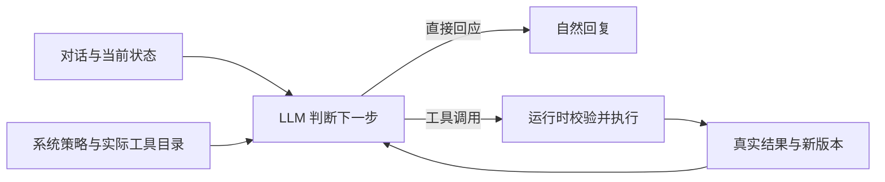

# 0.9.0：模型驱动的工具运行时

2026-11-03，按用户要求调整为类 Harness 的运行方式，独立实现，不导入外部 Agent 项目。此前 0.8 依靠关键词开放工具的做法已移除。

## 分工

**模型负责语义与选择。** 系统提示词说明各类工具的用途、持久化边界、技能读取和成功/失败处理；工具参数通过真实函数定义提供。模型结合上下文，选择直接回应、读取指引、搜索、提出记忆/事件候选、调整交流偏好或操作共同活动。自然问句、委婉表达和上下文确认都可以表达意愿，不要求用户使用命令词。

**运行时负责执行边界。** 注册表只包含当前环境和角色实际可用的工具；执行器继续检查工具名称、参数、角色作用域、数据版本、会话绑定、并发、次数和超时。不存在任意 shell 或外部消息权限。事件与事实仍是待审核候选，主动关怀的独立开关、预算和安静时段保留。

工具不会因为一句话含有或缺少“保存进展”“以后”“记住”等词而出现或消失；偏好、事件和活动工具不再使用这些硬编码意图函数。连发消息保留各自边界，统一进入模型判断；工具依据可以来自本轮任一真实用户消息，模型须尊重最新的纠正或撤回。

原文 evidence 只核对来源，不宣称机器已经证明了授权语义。是否是请求、否定、引述、例子、临时需要或长期意愿，由系统策略约束下的 LLM 判断。含糊时先自然追问；模型判断可能出错，已有面板继续提供查看、纠正与删除入口。

## 工具与内部指引

- 工具目录由执行注册表生成，模型看到的名称与后端允许执行的名称一致；网页工具仍由真实配置决定是否注册。
- `skill_load` 可按需读取角色的“倾听与陪伴”“日常回看”“一起想办法”指引。这些是工作说明，不是用户必须切换的模式，也不新增权限；普通聊天通常无需读取。
- `shared_activity_open` 提供读取列表、新建和接续活动，模型可在普通会话中直接开始，自动选择整理标签，无需用户先打开面板。
- `shared_activity_update` 读取当前真实绑定和最新版本，可接在创建/接续结果后继续记录进展、暂停或结束。创建、恢复与绑定在同一文件提交；切换只影响当前会话，不改变旧活动的状态。
- `companion_preferences_update` 用于长期交流习惯；`memory_write` 用于事实候选；`episode_propose` 用于事件候选。系统策略说明三者与活动进度的区别，避免重复写入多个存储。

既有工具循环继续按“模型调用 → 完整参数校验 → 执行 → 结果回注 → 再次决策”运行。每步向模型说明剩余预算；工具额度用尽或到最后一次响应时，关闭工具调用并要求如实收尾。默认最多 4 次模型响应、4 次工具执行和 30 秒，不额外运行一个分类模型。

同一轮重复活动操作返回已保存结果；创建请求的去重不受模型换了一段依据原文影响。更新仍校验版本，不能跨角色或修改已经失效的记录。停止聊天不撤销已经成功的工具操作，失败不自动重放收费请求。

## 代码位置

- `internal/probe/tool_policy.go`：来自实际注册表的系统工具说明。
- `internal/probe/agent.go`、`provider.go`：有界执行循环、结果回注和最终回复边界。
- `internal/api/turn_evidence.go`：本轮真实用户文本的来源核对，不判断语义。
- `internal/api/activity_open.go`、`activity_chat.go`：模型选择的活动工具。
- `internal/companion/activities.go`：原子创建/接续/切换会话绑定。
- `internal/roles/defaults/companion/skills/`：按需读取的相处指引；已有同名自定义文件不覆盖。

## 验证与使用

只调整现有测试，未增加测试数量或矩阵。六项相关检查覆盖注册表与提示词、模型不调用工具的路径、无关键词表达、连发消息来源、创建后继续记录、重复调用、活动列表/切换、角色/版本/并发边界，以及工具预算耗尽后的无工具收尾。

服务器独立数据目录使用两轮 ecnu-max 对话：自然问句请求长期共读并留住进度，模型自行选择创建和记录工具；随后请求不改记录、只闲聊，模型零工具调用，活动、偏好、记忆、事件、待办与提醒状态均未改变。未自动重试收费请求，未使用生产个人数据；这验证了代表性场景，不等于保证所有语义判断都正确。

仍是 Go 标准库 + 原生网页，无新增第三方依赖。原 Android 0.7.0-debug / versionCode 7 兼容，顶部“刷新”加载新版；静态缓存为 pocket-shell-v12，不需要新安装包。原有模式参数仅兼容旧请求，不控制交流方式。

已发布 `20261103-harness-01`，Linux SHA-256 `04e9d7da772d2cd2231a7f45499c55bb3241466bcb285a7d34debc66b0bdc5a7`。升级前正常停机备份生产数据至 `/opt/pocket-agent/backups/pre-harness-20261103-01.tar.gz`（root-only）。线上健康、静态资源、鉴权与原 versionCode 7 更新清单验证通过；真实模型验收使用隔离目录，未修改生产活动或偏好。没有新的手机或长期运行验收。
