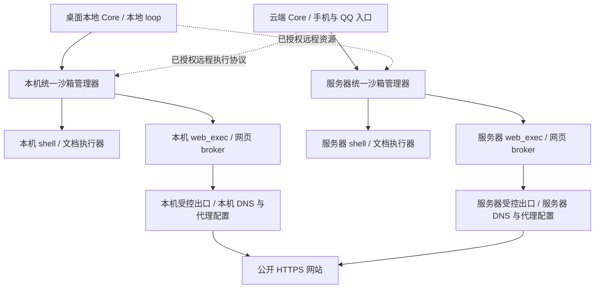

# CA 统一沙箱与双端网页执行：DSH 实施方案

日期：2026-11-29，同日修订为统一沙箱架构。初次源码评估基线为 `723845a`，本次修订时 HEAD 已为 `d53dc70`；第 2 节保留初次网页实现观察，接手时按最新源码校正。本文只修改设计与接手说明，不覆盖其他工作。

## 1. 目标与架构决定

交付一个本机和服务器都可使用的受限网页执行环境。LLM 可以像编排 shell 一样编写短脚本，自行选择网站、搜索、跳转、遍历链接、检查元素、处理表格和导出成果。浏览路径由模型根据观察决定，宿主负责网络、身份、资源、提交动作和持久结果。

核心设计为 **统一沙箱管理器 + shell/web_exec 等执行适配器 + 可续接的网页会话 + 受控网页对象 SDK**。`web_exec` 内含静态 HTTP/动态浏览器两个读取后端，与 shell 共用任务、授权范围、预算、取消恢复、工作目录和成果管理。简单查询继续使用兼容的 `web_search`/`web_fetch`，复杂任务由模型组合网页和 shell 能力。

Go Core 继续拥有 Harness、授权、任务和结算。沙箱管理器在现有能力上抽取，负责调度与强制执行策略；JavaScript/浏览器 worker 是其管理的执行组件，不另设网页专用调度、身份或结算系统。桌面本地 Core 使用本机网络，服务器 Core 使用服务器网络；两端采用同一协议和权限语义。电脑本地使用不依赖云端绑定。

这是待实施方案，不代表已安装浏览器、验证服务器出口或确认两端网络均可用。本轮没有访问生产配置、登录网站或执行真实模型任务。

### 可借鉴 GPT 的内容与边界

ChatGPT 搜索公开说明支持查询改写、根据结果继续搜索以及来源引用；OpenAI Web Search API 公开了 `search`、`open_page`、`find_in_page`。这些说明可以支持“连续研究”的产品设计，但不能据此宣称掌握网页版内部实现，也不能把 API 动作直接等同于其内部协议。[ChatGPT 搜索](https://help.openai.com/en/articles/9237897-searching-the-web-with-chatgpt)、[Web Search API](https://developers.openai.com/api/docs/guides/tools-web-search)。

采用可复用的公开组件实现相应能力：Playwright 的页面操作、结构观察和网络控制；微软 Playwright MCP 的快照/元素定位设计；成熟 HTML 与正文解析。搜索索引质量仍由搜索来源决定，浏览器不会自动修复不相关的搜索结果。[Playwright Library](https://playwright.dev/docs/library)、[Playwright MCP](https://github.com/microsoft/playwright-mcp)。

## 2. 当前代码需要改变什么

| 当前实现 | 已读到的限制 | 改造要求 |
| --- | --- | --- |
| `internal/webtools/search.go` | 正则匹配 Bing `b_algo`、`h2/a` 结构 | 引擎适配器分离；DOM 解析；区分结果为空、结构变化、验证码与错误页 |
| `internal/webtools/client.go` | 一律拒绝跳转；HTTPS 443；响应 256 KiB，正文 12 KiB；去标签后丢失结构 | 保留 HTTPS 出站边界；逐跳验证重定向；正文分页、元素和来源可继续查询 |
| 同一 Client | 多类网络问题合并成笼统错误，主要配置一个引擎 | 分阶段错误、可观测出口、单来源降级与有界重试；不静默切换付费来源 |
| `plugins/builtin/search` | 只有 query/url；“只能先搜裸词”等策略写死在指引 | 提供组合操作和实际能力说明，允许模型保留限定词、按来源修正查询 |
| `internal/localsearch` | 仍有旧 Bing RSS 包装实现和旧部署说明 | 实施前核实实际调用路径；统一到公开搜索 HTML 的适配器，不把旧说明当现网配置 |
| `internal/localagent` | 当前远端命令是固定 action；待执行任务包含内存状态 | 不假定它已经支持网页会话或任意脚本；扩展协商、持久派发和结果查回 |
| `internal/sandbox` | 非 Linux 明确返回不可用；现有 Linux shell 策略禁止网络 socket | 网页执行采用独立策略与 broker，不能给旧 shell 简单解除网络限制 |

上表是源码限制，不是线上故障比例诊断。首个实施步骤是记录真实失败所属层，不能预先把所有问题归为 Bing、DNS 或模型不会搜索。

## 3. 双端部署与网络选择



| 使用情景 | 默认执行位置 | 行为 |
| --- | --- | --- |
| 打开桌面本地 CA | 本机 | 启动本机 broker，直接工作，不要求云端登记或手填 token |
| 手机 App / 云端 Web / QQ | 服务器 | 请求服务器 broker，本机电脑关机不影响公开网页检索 |
| 在本机通过 SSH 隧道打开云端 UI | 服务器 | UI 在哪里打开与抓取在哪里执行是两回事 |
| 云端任务明确使用这台电脑网络 | 已获准的本机执行端 | 电脑在线且宣布可用能力后，云端派发；不是让手机 WebView 执行抓取 |
| 当前环境不能完成访问 | 保持当前会话并报告 | 只有预先允许的出口集合才能提出/执行切换；不把安全拒绝、验证码、账号限制当作切换理由 |

### 执行端身份与选择

执行端发布宿主生成的 `endpoint_id`、类型、在线状态、协议/SDK 版本、HTTP/浏览器/导出能力、沙盒状态和网络 profile。模型看到的是可用能力与不透明 ID，不接触代理密码、浏览器控制端口、CA 数据目录或账户密钥。

`target=auto` 默认选择当前 Core 的本地执行端；`local` 表示获准的用户电脑，`server` 表示获准的云端执行环境。多个电脑需要具体 endpoint ID，不能根据“最近在线”随意改用另一台。会话创建后固定 endpoint，已有 session 与冲突 target 返回错误。

同一账户的信任设备等效；设备信任不代表该设备当前运行着网页执行器。桌面端首次启用远程网页能力时，通过已有账户 challenge 建立受限执行身份并发布能力，后续无感重连，不再维护另一组手工 `device:token`。远程服务使用账户范围、可撤销、短期凭据；浏览器任务不得读取身份私钥。原远端固定 action 协议保留兼容，不把网页脚本塞进 action 字段。

两端 Core 均可独立使用。云端调用本机只发送当前任务所需的脚本、输入和授权范围，不复制整个历史、模型 Key 或无关记忆。远程 broker 通过现有加密连接/执行端载体接入，不开放公网 CDP 或浏览器管理端口。

### 出口、代理与局域网

“使用本机网络”指请求从本机发出，**不自动授权访问局域网**。本机和服务器的默认 profile 均仅允许公开 HTTPS，继续执行拒绝私有/保留地址、混合 DNS、固定已校验 IP、体积/时长限制。

直接出口由 broker 解析 DNS 并连接已验证 IP，TLS 校验保留原域名。代理由宿主配置为不透明 profile；不得把机器的环境代理变量原样交给模型。代理模式也必须证明目标解析与最终连接在受信边界内受到约束：若第三方 CONNECT 代理自行解析目标、无法保证 IP 约束，则该 profile 不作为默认可信后端。不能只验证一次本机 DNS，随后让代理重解析另一地址。

未来若访问 NAS、路由器、校内系统，应新增独立授权 profile，限定具体主机/端口/受众，而不是将 `allow_private=true` 作为模型参数。本方案首版保持现有公开 HTTPS 边界。目标站点被限流、验证码或登录限制时报告状态，不通过轮换出口规避。

## 4. 执行技术栈与强制边界

### 4.1 统一管理与执行契约

统一沙箱管理器是 Core 的执行协调层，下面的 shell、web_exec、文档执行器实现各自运行时。现有 `internal/sandbox` 继续承担平台隔离原语；协调层可按依赖放入 `internal/execution` 或已有相应模块，不将业务存储和网页解析塞进底层 sandbox 包。名称可以调整，单一职责和权威状态不能改变。

| 共用职责 | 权威归属 | 执行器职责 |
| --- | --- | --- |
| Task/Run/Operation、幂等与结算 | Core 现有任务/运行记录体系 | 回报启动、进度、真实结果和业务回执，不另生成一套任务状态 |
| 账户、设备、授权范围 | Core 授权服务 | 校验宿主签发的执行上下文；网页 session 不能自授 shell 权限 |
| endpoint 与平台能力 | 统一执行端目录 | 宣布实际可用的 shell、HTTP、浏览器及隔离能力 |
| 资源与期限 | 统一任务预算与执行租约 | 执行进程级限制，报告资源使用；多个执行器合计记账 |
| 取消、恢复与清理 | 管理器及现有持久 job 机制 | 终止自己的子进程/请求，核实终态并回收私有资源 |
| 文件和成果 | 统一工作区、Artifact 与权限服务 | 只访问获准挂载/句柄，校验并登记成果 |
| 网页页面、定位器、渲染 | web_exec 适配器 | 维护领域特有状态，不能替代 Task/Operation 的权威状态 |

概念上的执行请求包含 `task_id/run_id/operation_id/endpoint_id`、执行类型、工作区引用、授权引用及版本、策略引用、预算和输入摘要，由宿主补齐。适配器遵循准备、执行、查询、取消、收集成果、释放的同一生命周期；不要求统一成一个庞大的任意参数接口。

同一任务在同一执行端复用执行作用域，shell 与网页调用各自是独立 operation。每次调度仍验证当前授权与撤销状态。有效权限是用户授权、任务范围、执行器能力及平台强制策略的交集，不能把不同执行器的权限取并集。

### 4.2 共用工作区与连续编排

典型完整流程：网页读取并保存获准附件 → shell 清洗/计算 → 网页继续核对来源 → 导出报告。模型在同一 Harness 中选择工具，不要求用户切换模式。一次有效任务授权覆盖范围内的连续处理，扩大文件范围、上传或改变外部状态时才进入对应授权。

同一任务可以共用获准工作目录，但共享的是资料和成果。浏览器 profile、Cookie、代理凭据、broker IPC/CDP、身份密钥与控制记录位于私有目录，不挂载给 shell，也不导出到 guest。共享管理不要求 shell 与浏览器运行在同一个进程、容器或网络命名空间；它们可作为同一任务下权限不同的子执行单元。

文件交接通过工作区/Artifact 服务进行：下载先写私有暂存区，限制大小、校验类型和 hash，完成后原子发布到任务共享区；失败或未完成下载不能成为正式输入。模型可在授权任务目录内编排 shell，无需逐个命令预登记。修改同一文件要串行或做版本/hash 检查；交接时重新校验路径与符号链接，不能凭一次路径检查永久信任后续文件。

抓取资料进入 shell 时仍是不可信输入，文件名、网页文字不能直接拼进命令执行。网页向任务目录保存文件不等于获准将目录上传到站点；任何外发重新校验目标、内容范围和原授权。跨端协作传输明确选中的 Artifact，并保留 hash 与来源，不把整个本机工作区自动同步到服务器。

### 4.3 能力策略配置

以下是宿主策略配置，不作为用户必须手选的对话模式，也不是模型可自行扩大权限的参数：

| 能力 | 文件范围 | 网络与动作范围 |
| --- | --- | --- |
| shell | 已批准的任务目录，必要的程序目录只读 | 沿用现有网络限制；启动 web_exec 不给 shell 解禁 socket |
| 公开网页读取 | 任务输入、网页私有临时目录、显式成果出口 | 通过 broker 访问公开 HTTPS；受控导航、提取与站内搜索 |
| 获准登录浏览（后续） | 隔离且不可交给 shell 的登录 profile | 额外绑定账号/站点/动作授权，不能继承任意账户管理权 |
| 文档/图像处理 | 选定输入与任务输出目录 | 按该执行器已声明的需要配置；不继承浏览器网络权限 |

组合任务不是一个自动获得全部权限的“mixed”配置。网页 broker 可以在本任务已有网络授权内工作；shell 若需要联网，应调用同一受控能力或取得独立授权，不能通过共享浏览器调试端口绕过边界。

### 4.4 技术组件

| 组件 | 选择与职责 |
| --- | --- |
| Go 沙箱管理层 | 复用 Core 任务/授权/持久 job 服务，统一调度各执行器、预算、工作区和平台隔离；不新增网页专用任务库 |
| Go 网页领域层 | 维护 page/session、来源与出站适配，向统一操作记录及 Artifact 服务提交结果；`golang.org/x/net/html` 解析静态 DOM |
| 脚本 guest | `quickjs-emscripten` 的 QuickJS/WASM，执行标准 JavaScript、循环、函数、数组与 JSON 处理；只注入受控 SDK |
| 浏览器 broker | 固定版本 Node + Playwright Library + Chromium；由宿主代码持有 browser/page 对象，向 guest 返回受限句柄及序列化数据 |
| 正文提取 | 静态 DOM 结构提取为基础，文章页可适配 Mozilla Readability；主页/目录/论坛不强制用文章提取器 |
| 数据 | 网页 session/快照只保存领域状态，引用统一 operation/job；已完成 SQLite 迁移则复用，否则沿用现有持久接口，不维护平行台账；页面与成果按任务总配额保存 |
| UI | 使用现有工具卡与工作台；后续 React 迁移不影响工具协议上线 |

Go HTML parser、QuickJS/WASM 和 Readability 均有公开实现，可固定版本后复用；引入时核对文件、传递依赖和许可证并更新 notices。[Go HTML](https://pkg.go.dev/golang.org/x/net/html)、[QuickJS/WASM](https://github.com/justjake/quickjs-emscripten)、[Readability](https://github.com/mozilla/readability)。

### 为什么采用 guest + broker

LLM 可以写程序，但程序不直接拥有 Node 的 `process`、`require`、文件系统、原生 fetch、socket、CDP 或宿主 Playwright 对象。guest 通过明确注册的异步宿主函数调用网页能力；对象参数/返回值经过 schema、长度、深度及身份检查。guest 模块加载器默认拒绝外部模块，安装依赖不是模型动作。

这保留算法和流程自由，同时让每个实际网络/浏览器动作都经过可校验的 broker。不能仅使用 `node:vm` 或 JavaScript 字符串黑名单执行不可信代码。QuickJS 设置内存/栈/执行中断上限；父进程另设墙钟和进程终止，异步宿主调用同样可取消，不把“能打断 JS 循环”当作能取消浏览器请求。

用户代码不在真实网页中任意 `evaluate`。复杂 DOM 处理通过完整度可控的快照、结构化节点及离线处理完成；broker 的页面提取脚本是固定宿主代码。模型可以自行组合 CSS/语义定位器、遍历和转换，但不能在真实页脚本上下文运行任意网络、存储或原型修改代码。

### 两个平台的隔离交付

- **Linux 服务器**：独立低权限 worker，保留 Chromium sandbox，限制 CPU/内存/进程数/临时目录，禁挂 CA 配置、密钥和用户主目录。为浏览器提供独立网络策略，而不是复用禁止所有 socket 的工作区 shell 策略。浏览器仅能经过受控出口，直接外联被系统策略阻断。
- **Windows 本机**：同一 SDK/guest/broker，guest 无宿主权限；浏览器运行在专用临时 profile，保留 Chromium sandbox。使用 OS 启动适配器与 Job Object 管理进程树，实际文件/网络约束由经过验证的 AppContainer/等效策略提供，不能把 Job Object 本身称为权限沙盒。
- 安全能力由启动探针报告。任一平台浏览器隔离或出站强制策略尚不可用时，仅提供受控 HTTP 能力并返回 `BROWSER_UNAVAILABLE`；这属于明确降级，**不能作为“双端动态浏览已完成”的交付**。两端完整交付都需要实际打开动态页的证据。

BrowserContext 隔离 Cookie/站点状态，但不是操作系统安全边界。Playwright 官方也区分可信测试和不可信网页的运行配置，不能照搬默认 root 测试容器作为生产浏览器沙盒。[BrowserContext](https://playwright.dev/docs/browser-contexts)、[运行配置](https://playwright.dev/docs/docker)。

## 5. 模型接口与网页对象

以下均为拟议接口。沿用 CA 现有 request、operation 和 job 标识，由宿主生成/注入；模型不能自报用户身份、已批准状态或权限等级。

主工具 `web_exec` 输入：`code`、可选 JSON `input`、可选 `session_id`、`target`、可选 `endpoint_id`。宿主注入当前 Task、执行作用域、工作区及授权引用，不能让模型通过任意 task ID 接入别人的工作区。请求经统一沙箱管理器调度 web 适配器。短脚本同步返回；长脚本返回统一 operation/job 引用，用与 shell 相同的状态/取消入口查询。返回信封至少包含协议版本、session/endpoint/operation ID、状态、输出引用、来源、成果、错误与剩余预算；失败时也保留已完成动作和部分成果。

保留 `web_search`/`web_fetch` 兼容入口，但内部复用同一服务、错误分类与来源记录，不长期维护三套抓取实现。辅助的状态/关闭能力可放入 SDK，避免将每个对象方法都注册为单独 LLM 工具。

| SDK 对象 | 可组合能力 |
| --- | --- |
| `web` | 查询获准环境、搜索、打开 URL、恢复页面句柄、读取帮助、列出本会话标签页 |
| `page` | 标题/URL/快照、正文分页、目录、链接、图表/表格、图片说明、附件、局部查找、截图 |
| `locator` | 按语义角色/名称或 CSS 定位、计数、可见文本、允许的属性、子节点查询、跟随链接或受控交互 |
| `response` | HTTP 状态、类型、最终 URL、跳转链、内容引用、截断与解析质量；支持 JSON/文本等公开响应 |
| `data` | 普通 JS 数组/对象，模型可自行过滤、排序、比较、聚合，不消耗额外模型回合 |
| `artifacts` | 导出 JSON/CSV/Markdown、截图、获准附件，返回 CA Artifact 引用，不能写任意宿主路径 |
| `workspace` | 通过 broker 读取/发布本任务获准资料，与 shell 交接文件；按相对路径/文件引用、大小与版本校验，不暴露通用宿主 fs |
| `emit` | 返回有界观察结果；完整内容留在快照/成果中，后续按需读取 |

示例只说明拟议调用方式，不是当前可执行代码：

```javascript
const p = await web.open(input.url, { mode: "auto" });
emit(await p.snapshot({ view: "outline" }));

// 模型看见目录后，在下一次 web_exec 中自行选择入口。
const p = await web.page(state.page_id);
const candidates = await p.links({ region: "main" });
const selected = candidates.filter(x => /招生|课程|公告/.test(x.text));
emit(selected.slice(0, 12));

// 选定实际观察到的链接，继续访问，处理页面对象。
const detail = await p.follow(input.link_ref);
const rows = await detail.table(input.table_ref);
const result = rows.filter(row => row.year === input.year);
emit(await artifacts.save({ name: "results.json", data: result }));
```

上面的三段是三次脚本调用，模型之间可以观察并调整。第一次观察的页面 ID 由宿主记录为 `state.page_id`；示例中的链接/表格引用来自实际观察，不允许凭空构造。一次调用内也允许循环和有界并发；不要求走固定“搜索→详情→总结”流程。网页会话保留页面与显式 JSON `state`，不承诺任意 JS 变量/Promise 跨调用或进程重启存活。显式状态更新带 revision 并由宿主持久提交，与外部网页动作的结果分开记录。先提供 `web.help()` 及少量组合示例，其余方法按需发现，避免大段 API 文档常驻提示词。

### 定位与快照

每个 page、snapshot、element/link 引用都绑定账户、网页 session、endpoint、页面 revision。跳转或相关 DOM 变化使旧元素引用失效，返回 `STALE_REF` 及重新观察建议，不偷偷点击同位置的新元素。CSS 和语义 locator 可以重新求值；多匹配返回候选，不能默认点击第一项。

静态页可以提供 DOM 链接/正文/表格，但不能声称有浏览器计算出的真实可见性。动态页优先提供语义/可访问性结构，必要时补 DOM 区域与截图；Canvas 和图片文字不能靠 accessibility tree 保证可读。[Playwright 快照](https://playwright.dev/docs/aria-snapshots)。

### 页面类型与处理策略

| 页面 | 默认观察 | 可继续探索 |
| --- | --- | --- |
| 网站主页/栏目 | 导航、主要分区、链接、站内搜索入口 | 选择栏目、跟随子页、读取分页 |
| 文档站/知识库 | 目录、标题、段落、代码块 | 站内查找、锚点定位、关联章节 |
| 新闻/文章 | 正文、作者/日期候选、相关链接 | 原始来源、引用文献、历史版本 |
| 论坛/讨论 | 楼层、作者、时间、引用与分页 | 读取上下文，区分楼主内容与回复 |
| 商品/列表/数据页 | 行列/条目、单位、价格时间等原始字段 | 筛选、对比、导出；不自动购买 |
| PDF/附件 | 内容类型、大小、原件引用 | 交给既有文档处理能力，不把二进制当 HTML |
| 动态或视觉页 | 渲染后快照，必要时截图 | 展开、滚动加载、读取当前可见内容 |

网页类型是提取策略提示，不是固定域名白名单。网站特有适配器只能改善通用能力，不成为访问新网站的前置条件。图片/视频页只能报告实际获取的文字、字幕或画面，不能根据标题声称已经看完视频。

## 6. 搜索与网络可靠性

搜索继续使用搜索引擎公开 HTML + 候选解析；需原文时读取目标页面，沿用 AGENTS.md。适配器记录引擎、原查询、实际查询、语言/地区和解析版本。限定词和中文短语应保留；简化查询作为可观察的策略尝试，不能静默把用户意图改成一个词。

支持多个明确配置、已验证可用的公开 HTML 来源。不要预先承诺某个搜索引擎在两种网络环境必然可达；环境健康记录分别维护。一个适配器失败可在授权的来源集合内有界回退，验证码/登录墙不反复撞。相关性重叠只作为质量信号，不等同语义排名，更不能把“存在某个查询词”当作证据充分。

静态读取优先，发现空应用壳、缺失主体或用户明确需要交互时启动浏览器；HTTP 的 401/403/429 与安全拒绝不能被机械转换为浏览器重试。使用 DOMContentLoaded + 目标元素/结构稳定的有界等待，不把 networkidle 当作所有页面完成的标准。

### 强制出站策略

所有重定向逐跳检查协议、域名、端口、DNS 与 IP；跨域不能携带上一个站点的凭据。URL fragment 用于本地锚点，获取时剥离并记录定位，不能因普通 `#section` 拒绝整页。相对链接由合法 base URL 解析，canonical/base 标签只是待校验数据。

浏览器的子资源、iframe、XHR/fetch、弹窗与下载同样经过策略；阻断 service worker 绕过、直接 socket、未授权 WebSocket/WebRTC 和外部协议。仅配置 Playwright route 不足以证明网络隔离，需系统出口约束配合；broker 内置 HTTP 客户端也不能绕过同一策略。[Playwright 网络控制](https://playwright.dev/docs/network)。

默认匿名公开阅读，允许链接导航、展开与滚动。站内搜索按经校验的表单/站点规则处理；未知表单、上传、发送、账号修改等进入独立动作授权。HTTP 方法本身不能证明没有副作用，GET 也可能改变网站状态。无登录凭据并不等同于所有点击都安全，不能向模型提供“任意 click 等于只读”的承诺。

登录访问作为后续显式能力，用户在对应环境完成登录，使用独立加密 profile。首版不导入个人浏览器 Cookie，不将登录 profile 跨电脑/服务器搬运。网页内容与截图均为不可信资料，不能触发提权或读取无关本地文件。

### 结构化错误

统一返回 `stage`、`code`、`retryable`、可选 `retry_after`、`endpoint_id`、操作 ID、已取得的部分结果及建议动作；错误不能被当作成功正文。

| 错误 | 模型可采取的动作 |
| --- | --- |
| `DNS_FAILED` / `CONNECT_TIMEOUT` / `TLS_FAILED` | 报告当前出口问题；按预算重试或提议获准出口 |
| `RATE_LIMITED` | 尊重 Retry-After，等待/停止，不循环换 IP |
| `ACCESS_DENIED` / `LOGIN_REQUIRED` / `CHALLENGE_REQUIRED` | 如实说明限制；不伪装空结果 |
| `SEARCH_PARSE_FAILED` / `LOW_RELEVANCE` | 换解析/查询/获准来源；保留诊断身份 |
| `NEEDS_RENDER` / `BROWSER_UNAVAILABLE` | 使用当前端浏览器，或说明降级与可选环境 |
| `STALE_REF` / `MULTIPLE_MATCHES` | 重新观察并定位 |
| `POLICY_DENIED` | 说明具体边界，不自动更换出口规避 |
| `OUTPUT_TRUNCATED` / `BUDGET_EXHAUSTED` | 按引用续读或交付已有成果 |
| `OUTCOME_UNKNOWN` | 查询原 operation；涉及提交时不自动重放脚本 |

保留每端 DNS/TLS/首字节/下载/解析/渲染耗时和错误类别，查询正文、Cookie、Authorization 默认不写通用日志。诊断采样只能保存经脱敏的最小片段；页面正文按用户数据规则存放。

## 7. 网页会话、持久性与 Harness

网页 session 是统一任务执行作用域中的资源，隶属账户/角色/任务，绑定 endpoint、执行代和权限版本。浏览器会话按账户和任务隔离，不能让另一用户复用相同 Cookie。关闭某个网页 session 只释放其页面/profile，不取消同任务中无关的 shell operation，也不删除共享资料。任务级取消由管理器传播到所有活跃子执行单元；全部结束并完成成果收集后才清理共享目录。快照和已登记成果按保留策略存活。

脚本执行前持久记录 operation 与代码/输入摘要；同 ID 同参数重试返回原操作，不自动重新执行。每个宿主动作附带子操作身份、状态和来源引用。脚本超时不是该脚本所有动作回滚；guest 消失后还在运行的导航/下载要终止或独立结算，不能写入后续新会话。

租约到期、取消或 worker 重启会结束旧执行代；晚到的结果不能覆盖新执行代的状态。网页子动作是该 operation 的明细，不能各自建立新的调度队列和另一套幂等规则。任务级预算累计 shell、浏览器、guest 与文档处理使用量；子操作限额在任务剩余额度内分配，换工具或新建网页 session 不重置额度。

进程重启后：已保存的文本/表格/截图可读；浏览器句柄标记失效；匿名只读页面可显式重新打开，生成新 snapshot；Cookie、交互状态与未保存页面不假装恢复。未知提交保持待核实。跨端切换创建新的网页 session，只传获准 URL、必要显式状态和资料引用，旧环境的观察保留来源。

与 Harness 对接：工具结果区分供模型的摘要、结构化 Data、运行回执和用户视图。持续任务可等待 operation 完成再继续；同一个状态查询不能被重复调用守卫强制收尾。网页内容不全量塞入历史，使用快照引用和分页读取；模型仍可根据观察自行决定是否继续。

建议首版默认值作为配置起点：每任务 2 个页面、单页面浏览器等待 20 秒、单脚本墙钟 45 秒、单任务累计网络请求/字节预算、每端先允许 1 个动态任务并发。具体字节/内存额度由两端环境测量后确定；浏览器预算按整个任务累计，不靠分多次 `web_exec` 绕过。长任务走 job，不无限延长同步工具调用。

## 8. UI 与成果

对话内只显示紧凑进度：“正在学校官网查找公告 · 本机网络”。展开后查看已访问站点、当前页面、遇到的限制和下一步；默认不刷屏展示 DOM 或完整脚本。用户可打开网页工作台查看目录、页面截图、提取表格、来源与导出成果。

执行位置属于统一任务状态，电脑/服务器切换在任务卡中完成，不新增多层侧栏设置。一个任务卡连续呈现“检索资料→处理文件→核对来源→生成报告”，网页与 shell 不拆成两个任务中心。可以停止当前操作或整个任务，文案清楚区分作用范围。失联时显示“电脑离线，任务等待连接”，不能说网站故障；浏览器不可用与网络不可用分别表达。

引用绑定 URL、最终 URL、访问时间、snapshot/hash、段落或元素位置。搜索摘要标为摘要，不能标作已读原文。用户打开引用可以看到使用的资料片段及原网页，页面改版后历史证据仍可追溯。快照不是自动允许长篇公开转载，回复仍按任务需要摘取与概述。

截图、表格和下载文件统一注册为 Artifact，经 CA 鉴权查看/下载，支持 Android 文件保存；不把 worker 临时路径或 CDP URL 暴露给用户。网页 HTML 不直接嵌入已登录 CA origin；预览使用净化内容/隔离视图，不执行远端脚本。Readability 负责正文提取，本身不承担输出净化。[Readability 安全说明](https://github.com/mozilla/readability#security)。

## 9. DSH 实施落点与依赖

以下目录名为建议，优先复用已有职责，不机械创建平行框架：

| 范围 | 接入位置 | 交付 |
| --- | --- | --- |
| 统一沙箱管理 | 复用 `internal/sandbox` 平台后端，按依赖抽取执行协调层 | 统一执行上下文、策略、任务预算、租约、工作区和各适配器生命周期 |
| 网页领域/出站 | `internal/webtools`，必要时抽 `internal/webexec` | 统一请求、结构解析、会话、错误与来源 |
| 模型工具 | `plugins/builtin/search`、`internal/pluginapi` | `web_exec` 和兼容入口，同一能力目录与宿主授权 |
| guest/broker | 由统一管理器托管的 worker 包与平台启动器 | 锁定 Node/QuickJS/Playwright/Chromium，受控 SDK，执行统一取消与清理 |
| 两端启动 | `cmd/server` 桌面/服务器启动分支、平台适配器 | 本机自动发现/启动；服务器 systemd；健康与能力探针 |
| 远程执行 | `internal/localagent`、`internal/api/local_agent.go` 的协议演进 | 设备能力协商、可撤销执行身份、持久派发、查回与成果传输 |
| 任务与结算 | `internal/turns`、`internal/runlog`、既有 job 接口 | shell/web 共用操作身份、恢复、不可重放状态及成果；不新增网页专用权威台账 |
| 展示与下载 | 现有工具卡、工作台、Artifact API、Kotlin 文件桥 | 执行位置、观察记录、引用和成果，无重复管理菜单 |

实施顺序按依赖组织，不另排版本：先沿现有 shell/job 路径抽取最小共用执行契约并保持兼容 → 接入静态网页对象和错误分类 → web 适配器中的 guest/broker → 两个平台动态浏览与强制出口 → shell/web 文件协作、远程续接及统一 UI。现有 job 服务缺少持久性时，在共用层补齐一次；不先为 web 实现一套再迁移。避免等待全项目抽象重构，先让 shell 与 web 两个真实消费者验证接口。静态读取能够先交付，但整项完成必须覆盖本机与服务器动态能力。

启动时分开探测“进程在线、策略生效、HTTP 可用、浏览器可用、搜索来源可用”；health 不应每次触发真实搜索。两端从同一发布清单安装依赖，首次初始化不能要求用户手工拼 Node 命令。服务器不新增公网端口；本机端口只监听回环或使用受 ACL 保护的 IPC。管理员权限/系统策略初始化若必需，应集中说明，不能静默关闭安全策略使探针通过。

克隆 Playwright MCP/CLI 等上游到独立参考目录，固定 commit，优先复用快照/定位/生命周期与错误处理。DSH 中适合的工具呈现、jobs 和执行适配继续复用。记录每个采用文件、目标文件与许可证；仅有同名工具不能声称兼容整个上游运行时。

## 10. 最小合并验收与交接

代码验证以可控 fixture 为主，测试目标是协议/网络边界/恢复，而不是断言某个搜索引擎永远在线：

1. 一个包含主页、相对链接、表格、分页及动态内容的站点夹具，完成 web 观察/下载→shell 清洗→web 核对来源→导出报告；本机和 Linux 后端各走一次同一流程。全程共用 Task/工作区/预算，操作及来源分别可查。
2. 安全重定向能跟随；跳向私网/保留 IP、DNS 重绑定、浏览器子资源绕行被拒绝。测试 resolver/transport 注入必须仅限测试，生产不能新增全局“允许测试内网”开关。
3. 超时、429、验证码、无结果、结构变化和截断分别返回正确状态；检索/浏览器失败不伪装成功正文。
4. guest 无限循环、内存/宿主调用预算、过期元素和跨会话句柄拒绝；不能读环境变量、宿主文件或建立裸连接。网页启用后 shell 仍不能绕过网络策略或读取 Cookie/profile；切换工具不重置任务预算。
5. 断线/重启后查询同 operation 不重复执行；跨端切换不搬 Cookie；导出文件在 App/Web 中可鉴权下载。单网页操作取消不误删 shell 输入，任务取消能终止全部子执行单元；晚到回执不能覆盖新执行代。

完成后用每端少量公开站点做一次真实网络检查，记录出口、HTTP/动态能力和限制；再用同一合成任务在已配置 LLM 上做一次探索式使用，记录它是否能发现入口、处理失败、继续阅读和给出真实引用。无需使用私人历史或登录网站。真实网络/模型检查不每改一个函数重复执行。

实现完成后按 AGENTS.md 合批做构建/vet/受影响测试与双端发布，额外验证 worker 安装清单和浏览器版本匹配。记录备份、服务器与 APK 版本/校验和、worker 版本、健康与回退；新能力回退应保留既有搜索/读取兼容入口及已登记成果。源码、网络实测、真实模型使用和部署证据分别报告。

可直接交给 DSH：

> 按本文实现统一沙箱体系中的双端 web_exec。先核对 HEAD、AGENTS.md 和工作区改动，保留他人工作，不启动子代理。沿现有 shell/job 路径抽取共用执行协调层，web_exec 作为适配器接入，任务/授权/预算/取消恢复/成果共用，网页 session 只保存领域状态。让 LLM 在同一任务内自由编排浏览、文件处理和来源核对；共享获准资料目录，不共享 Cookie/凭据或合并网络权限。桌面默认本机网络，云端默认服务器网络，跨端使用同一账户的获准资源。两端都落实 guest/broker/OS 边界，不用裸 Node 或关闭 Chromium sandbox 代替隔离。复用成熟组件并记录许可，以合并场景验证后完成已授权范围的合批推送和服务器/APK 部署；只完成服务器、静态 fetch 或 mock 不算整项完成。
